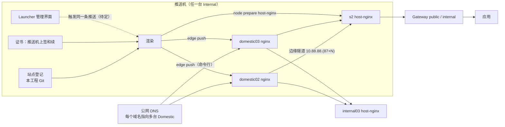

# 61. v2.launcher 管理域名、公网站点从 Internal 推送、MinCave 两端的包

日期：2026-11-25。状态：分三部分。
- 第 1、2 部分已实现，在 nginx 1.27.5 容器里测过（两个域名、三种模式），没有推到 domestic02。
- 第 3 部分是设计：de-mingxi 的配置怎么迁成从 Internal 推送、怎么负载，要用户定几件事。
- 第 4 部分是 MinCave 两端打包和连上 internal02 的步骤：打包脚本没写，等用户定身份。

用户 2026-11-25（附截图：`https://mincave.minsight-ai.com/admin/` 已经能打开 Launcher 的登录页）：
- 按之前 mx-h2i 的架构，v2 怎么打包双端的 MinCave，并且能通过 domestic02 连上 internal02。
- 后续可能会通过 DNS 负载到多台 Domestic，再通过 Domestic 的 nginx 负载到各个 Internal。
- 现在 Domestic 和 Internal 的部署在 `de-mingxi/compass/deploy/nginx`，de-mingxi 的其他目录可能也有。v2 要把这些 Domestic 和 Internal 的配置都做成从 Internal 推送：命令行和 Launcher 都能推，并按之前设计的架构负载。
- v2 的 Launcher 应该不能用 mincave，bootstrap url 可能是它；打算加一个 v2.launcher，怎么改。

本篇取代 `docs/60` 的默认值：`mincave.minsight-ai.com` 默认不再全部放行，改回只放客户端接口；全部放行的是新的管理域名。

## 1. 先处理：运维令牌进了 Git

- `architecture/architecture.setup.md`（用户的笔记）里有一行 64 位十六进制，看起来就是 Internal Ops Token。它在提交 `cc31121` 里，已经推到 `origin/prod`。
- `docs/60` 起管理后台对公网开着，所以拿到它就能进后台。
- 本轮已从工作区的笔记里删掉那一行，改成"去 s2 上看令牌文件"。**历史里还在，必须换令牌**（命令见本篇最后）。要不要改写 Git 历史由用户定；换了令牌以后，旧的就没用了。

## 2. 管理后台换到 v2.launcher，mincave 只做客户端的 bootstrap

照 v1 的分法：v1 是 `h2i.minsight-ai.com`（客户端白名单）加 `launcher.minsight-ai.com`（管理后台，`de-mingxi/compass/deploy/internal-nginx/launcher.minsight-ai.com.conf.example`）。

| 域名 | 角色 | 默认模式 | 放什么 |
|---|---|---|---|
| `mincave.minsight-ai.com` | bootstrap | `client` | 只有客户端接口（v1 的 `Caddyfile.public-tls` 白名单），`/admin/` 等一律 404 |
| `v2.launcher.minsight-ai.com` | admin | `open` | Launcher 的全部路由，鉴权交给 Launcher（`docs/60` 的风险照旧，第 78 项） |

- 全名是按 v1 的 `launcher.minsight-ai.com` 推的，**待用户确认**，写在 `inventory/hosts.yaml` 的 `admin_domain`。DNS 要解析到 domestic02（以后到所有 Domestic）。
- 三种模式按域名分别设，记在推送机的 edge state 里：
  - `client`：只放客户端接口，只给 bootstrap 域名用；
  - `open`：全部放行；
  - `restricted`：客户端接口加登记的来源。
- 证书按域名分别签。还没解析到这台的域名先跳过，DNS 好了以后单独签：`relay domestic02 cert --agree-tos --domain v2.launcher.minsight-ai.com`。
- Launcher 本身不用改：管理界面的"MX Server"默认就是当前访问的域名。Config Center 里 bootstrap 那一栏仍填 `mincave.minsight-ai.com`。

命令：

```bash
./scripts/manage.sh relay domestic02 site
```

```bash
PROXY=http://127.0.0.1:7788 ./scripts/manage.sh relay domestic02 cert --agree-tos --domain v2.launcher.minsight-ai.com
```

想改模式：`--bootstrap-access client|open|restricted`、`--admin-access open|restricted`，加 `--admin-allow <IP,...>`。`docs/60` 的旧开关 `--access` 当成 `--bootstrap-access` 用。

## 3. de-mingxi 的公网站点迁成从 Internal 推送，按架构负载（设计）

### 现在的样子（读 de-mingxi `da57e76` 的文件，没上机器看）

| 在哪 | 是什么 | 回源 |
|---|---|---|
| 生产 Domestic，`compass/deploy/nginx/conf.d`，Compose 里的 nginx 独占 443 | `10-compass`、`20-official`、`30-h2i`、`40-hub`、`50-delta`、`60-autotest`，按 SNI 分域名；`90-egress` 只听 `10.88.0.1:8081`（出网反代） | 大多是 `10.88.88.88:80`（经 Launcher 的中继到 s1 的宿主机 nginx）；`30-h2i` 到 `mx-domestic-edge:8088` |
| 生产 Domestic，`compass/deploy/certificates` | certbot 加 webroot（`mx-acme-location.conf`），证书在 Domestic 上 | — |
| s1，`compass/deploy/internal-nginx` | 按 `server_name` 分到各服务：compass、delta、hub、pay、auth、launcher、night-all-a、luopan desktop api | 本机端口、集群 ClusterIP、`10.88.88.88:18444` |
| 其它 | `official/deploy/nginx`、`night-all-a/deploy/nginx`、`notyet/deploy/nginx` | 各自的服务 |

都是在目标机上编辑、`nginx -t`、reload，证书也在 Domestic 上签。不是从 Internal 推的。

### 目标

照 `docs/18`、`docs/23`、`docs/37`–`docs/44` 已定的：



1. **一份站点登记，渲染成两头的配置。** 在本工程里登记每个公网站点：域名、角色、模式、后端（Gateway public、Gateway internal、Launcher，或者还在 s1 上的旧服务）、要不要流式、上传大小、健康检查。
   - 渲染出每台 Domestic 的 nginx 站点（边缘工具的 `wg-nginx` 推），以及每台 Internal 的 host-nginx 段（`node prepare host-nginx` 推）。
   - `relay domestic02 site` 是它的第一个实例，只有 Launcher 的两个域名。
   - 登记放 Git，证书和私钥放推送机，和现在一样。
2. **Domestic → 多台 Internal 的负载。** Domestic 的 nginx 用 `upstream`，列出每台 Internal 的边缘隧道地址（`10.88.88.(87+N)`）。
   - 设 `max_fails`、`fail_timeout`，加 `proxy_next_upstream error timeout`，一台挂了自动跳过。
   - 只在一台上跑的服务（现在的 Launcher 只在 s2）只列那一台。
   - Internal 之间不走边缘隧道，走 LAN（`docs/43`）。
3. **DNS → 多台 Domestic。** 每个域名写多条 A 记录，或者用 DNS 服务商的健康检查加权重。DNS 只在 Domestic 之间切，不指到 Internal（`docs/43`）。每台 Domestic 推的是同一份站点，证书由推送机签好分发。
   - 签证书走第一台 Domestic 的 80，经隧道到推送机。多台以后要么都把挑战转回推送机，要么改用 DNS 验证（要 DNS 服务商的 API 凭据，放推送机本地）。
4. **证书：** 照 `relay cert` 的做法，在推送机上签、续，放进每台 Domestic 的 edge state 推过去。
5. **命令行：** 把 `relay <主机> site/cert` 推广成 `edge sites plan|render|push [<主机>]`：
   - `plan` 列出每台 Domestic、每个域名、后端、证书状态；
   - `push` 推一台或全部 Domestic（一次一台，失败就停）。
6. **Launcher 管理界面也能推（要定方式）。** Launcher 管人和网络，站点登记在 L2 的 Git 里。两种办法：
   - 推荐：界面上的"推送公网站点"按钮，经 host-runner（s2 上已有，Launcher 管理界面建的）在推送机上跑同一条 `edge sites push`。只放这一个动作，参数不能自由填，结果回传到界面。
   - 另一种：站点登记搬进 Launcher 的库，界面编辑，L2 再从 Launcher 读。这把机器的事放进了 Launcher，和 `docs/21`、`docs/28` 的分工相反，不推荐。
7. **迁移顺序：**
   - 先迁后端已经在 L2 的（现在只有 Launcher 的两个域名）；
   - 其余站点等后端迁进 L2 再一个个迁；
   - 生产的 Domestic（domestic-main）切换之前一行都不动（`CLAUDE.md`）。
   - `90-egress`（出网反代）和 Launcher 的中继、DNS 是 Launcher 那边的东西，归 Launcher 的 Domestic 包，不进站点登记。

## 4. MinCave 两端的包，经 domestic02 连上 internal02

### 连上的步骤

照 v1 的架构：客户端 → domestic02 的中继 `mx-domestic`（10.88.0.1，UDP 51280）→ s2 的 `mx-internal-svc`（10.88.88.88）。

1. 中继：`docs/57` 第 1–5 步（docker、镜像、SSH Profile bootstrap、`launcher-key`、Domestic Runtime Config → Materialize → install）。不开 public-tls：443 归边缘工具（`docs/59`）。
2. 管理界面 → Internal Service Peer → Ensure K8s Fallback，再 Install：s2 用自己的新密钥连 `47.97.46.168:51280`（`docs/48`）。
3. 客户端的 `.env`：`architecture/mx-launcher/scripts/manage.sh client-env`。bootstrap 是 `https://mincave.minsight-ai.com`，中继地址是 domestic02 的。
4. 连上以后：`ssh root@10.88.88.88` 就是 internal02（`docs/52`）。

### 打包（`docs/59` 第 2–4 条，没实现）

- **做法：** 用 `git archive` 导出 L1 的 `1d9555e8`，叠上 L2 的 `demos/mx-h2i`，把上面的 `.env` 放进安装包的 `Resources/`，跑 L1 原来的打包命令。L1 本身不改。
- **macOS：** 在 Mac 上打（`make:mac:dmg`，universal）。没有 Developer ID 就和 v1 一样，要用户手动允许（第 77 项）。
- **Windows：** 在 Windows 上打（`make:win`）。要 Node 22、pnpm、Go 1.26 以上（编 MinCave Network Service），还要跑 PowerShell 的检查。
- **先要定的（第 67 项）：** 测试包和正式 MinCave 同一个 appId，装在有正式版的电脑上会覆盖它，还共用数据目录、WireGuard 服务和 Windows 网络服务。
  - 一种是只装在没有正式版的电脑上，打包脚本不用改客户端；
  - 另一种是给测试版换一套身份（appId、产品名、数据目录、服务名），要改客户端的主进程，用环境变量开关。

## 改了什么

| 在哪 | 改了什么 |
|---|---|
| `infra/edge/bootstrap-site.conf.tmpl`、`bootstrap-site.server.tmpl`（新） | 拆成公共部分（白名单、来源、模式表）和每个域名一段 server；模式按域名 |
| `scripts/lib/relay.sh` | 按域名渲染（`bootstrap_domain`、`admin_domain`）；`--bootstrap-access`、`--admin-access`；证书按域名签，没解析到这台的跳过，`--domain` 单签；续期按域名 |
| `inventory/hosts.yaml` | domestic02 加 `admin_domain: v2.launcher.minsight-ai.com`（待确认） |
| `scripts/manage.sh` | 帮助 |
| `architecture/architecture.setup.md` | 删掉令牌那一行（用户的笔记） |

## 实测（本机 nginx 容器，自签证书，假上游）

| 情况 | mincave `/admin/`、Config Center | mincave `POST /internal/v1/sdk/oauth/token` | v2.launcher `/admin/`、Config Center |
|---|---|---|---|
| 默认（client / open） | 404 | 转到上游 | 转到上游 |
| admin restricted，登记了本机 | 404 | 转到上游 | 转到上游 |
| admin restricted，登记了别的地址 | 404 | 转到上游 | 404 |

## 还要用户定的

- 管理域名的全名（第 79 项）。
- 第 3 部分：站点登记放哪、Launcher 界面怎么触发推送（第 80 项）、多台 Domestic 时签证书用 HTTP 还是 DNS 验证（第 81 项）。
- 第 67 项：测试包的身份。
