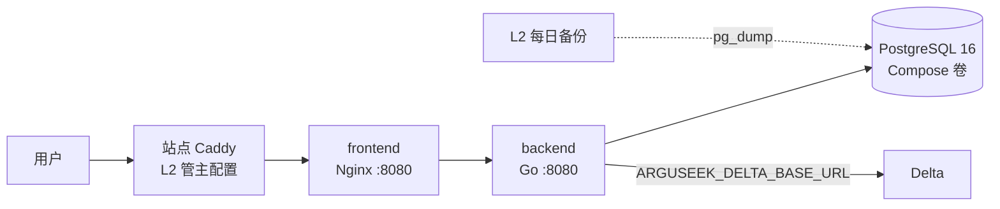

# arguseek

日期：2026-11-17。状态：登记和部署说明。内容抄自 arguseek 仓库（`/Users/qpjoy/workspace/mingxi/arguseek`，`inventory/projects.yaml` 的 `arguseek`），没有登录服务器核对。站点的整体设计在 `docs/33`。

toC 的 AI 风险研究工作台：React 单页、Go 后端、PostgreSQL 16，用 Docker Compose 跑在海外站点 `oversea-toc` 上（`inventory/hosts.yaml`）。各地都有用户；站点区域没定，按实测选，选定后从现在这台迁过去（`docs/34`）。

## 这个目录放什么

arguseek 有一套成熟的发布工具（打包校验、迁移前备份、健康检查、回滚守卫），都在它自己的仓库里。所以这里**不拷源码，也不拷它的 `compose.yaml`**，两份会走样。这里只放：

- 它在 L2 里的位置：跑在哪、依赖谁、数据在哪；
- 怎么调用它自己的发布工具；
- L2 这边补的东西：每日备份、探测、Caddy 的分工、改连 Delta 海外实例的步骤。



## 环境

| 环境 | 域名 | Compose 项目 | 回环端口 | 密钥文件（服务器上） |
|---|---|---|---|---|
| dev | `dev.arguseek.com` | `arguseek-dev` | `127.0.0.1:18080` | `/etc/arguseek/dev.env` |
| inhouse | `inhouse.arguseek.com` | `arguseek-inhouse` | `127.0.0.1:18081` | `/etc/arguseek/inhouse.env` |
| 正式 | 待定（`docs/15` 第 35 项） | | | |

两个环境的库、密钥、飞书应用都分开。发布包放 `/opt/arguseek/<环境>/releases/<tag>`，`current`、`previous` 两个链接指向当前和上一版。

## 发布、回滚、邀请码

在 arguseek 仓库根目录执行，详见它的 `ops/README.md`。本工程不包一层，也不改它的脚本。

```bash
ops/deploy.sh --env dev --tag <版本>        # 先 dev
ops/health.sh --env dev
ops/deploy.sh --env all --tag <版本>        # dev 之后再 inhouse
ops/health.sh --env all
ops/rollback.sh --env dev --yes             # 只回到 previous 指向的那一版
ops/invites.sh --env all list --active      # 只读；创建和吊销必须指定一个环境
```

- 默认 SSH 目标是 `root@54.208.24.231`，密钥 `~/.ssh/arguseek_deploy_ed25519`，可用 `ARGUSEEK_SSH_TARGET` 等环境变量覆盖。
- 线路不稳时加 `--public-via-remote`，公网检查改在服务器上跑。

## 和 L2 的接口

| 事 | 现在 | L2 的做法（`docs/33`） |
|---|---|---|
| Caddy | arguseek 的 `ops/Caddyfile` 两个站点 | 主 Caddyfile 归 L2，只 `import` 各项目的片段；arguseek 的两个站点作为一个片段 |
| 调 Delta | `https://dev.delta.minsight-ai.com`，跨境回内网 | Delta 海外实例上线后改连本机：Compose 覆盖文件里用 `extra_hosts` 把实例的域名指到宿主机，证书照常校验。先 dev 后 inhouse |
| 备份 | 发布前会备份；README 写着正式的自动备份还没做 | L2 每天 `pg_dump` 到同区域对象存储，每周由内网拉一份回 NAS，定期做还原演练 |
| 身份 HMAC 密钥 | 在 `/etc/arguseek/<环境>.env` | 另存密码管理器。丢了它，备份还原出来的邀请码和飞书凭据都用不了 |
| 静态文件 | 源站 Caddy 直接给 | 前端的 JS、CSS 放 CDN，接口和事件流走源站（`docs/34`） |
| 换区域 | — | 按它 README 里上云迁移的做法：停写、导库、带上 HMAC 密钥、跑迁移、切 DNS；旧机器保留 |
| 探测 | 它自己的 `ops/health.sh` | `inventory/probes.yaml` 的 `arguseek-dev`、`arguseek-inhouse`：`./scripts/manage.sh probe route arguseek-dev` |

改连 Delta 的回退：把 `ARGUSEEK_DELTA_BASE_URL` 改回原地址重新发布。切换前等进行中的研究跑完，两个 Delta 实例之间的会话不通用。

## 还没做的

- 没登录服务器核对：规格、区域、Caddy 现有配置、上面还有什么（`docs/15` 第 31 项）。
- 每日备份和拉回 NAS 的任务还没写（`manage.sh backup` 也没实现，`docs/19`）。
- Delta 海外实例还没有。已定给 arguseek 新开一个（用户 2026-11-17），由 po-infra 按本地存储模式部署；站点上现在有没有别的 Delta 在跑，现场核对时一起看（`docs/15` 第 31 项）。
- 正式环境的域名和上线时间（`docs/15` 第 35 项）。
- 站点区域：候选东京、新加坡，实测后定（`docs/15` 第 38 项）。
