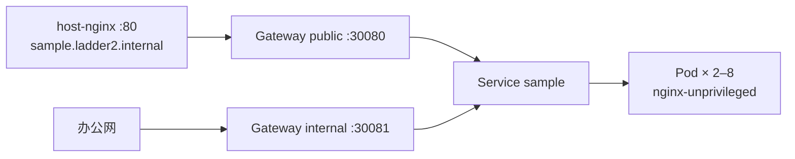

# sample

日期：2026-11-19。状态：清单，渲染通过；配置在本机 Docker 里 `nginx -t` 通过、跑过 300/s 的压测；没在集群上跑过。

L2 的样板服务（`docs/35`）。不访问数据库，只回固定内容，用来：

- 打通"host-nginx → Gateway → Pod"整条链路（阶段 12，`node verify s2 sample`）；
- 查网关认出的客户端地址对不对：`/whoami` 回显网关传来的 `X-Real-IP` 和 `X-Forwarded-For`；
- 量每一层能不能扛 1000 QPS（阶段 13，`loadtest`）。



| 路径 | 返回 | 用途 |
|---|---|---|
| `/healthz` | `ok` | 存活检查、探测、压测 |
| `/readyz` | `ok` | 就绪检查 |
| `/whoami` | 网关传来的客户端地址、请求编号、Host | 信任链检查 |
| 其他 | `sample` | |

部署和验证：

```bash
./scripts/manage.sh node prepare s2 sample --context ladder2
```

```bash
./scripts/manage.sh node verify s2 sample
```

- 镜像和 `templates/project` 相同，配置换成自己的 `deploy/k8s/base/nginx.conf`：镜像默认的 `worker_processes auto` 会按宿主机核数起进程。
- 访问日志关了，压测时每秒上千行日志本身是开销；请求编号在 host-nginx 那层记。
- 路由同时挂 `public` 和 `internal`，两个入口都能量。真正的业务只对内网开放时只挂 `internal`（`docs/18`）。
- 域名 `sample.ladder2.internal` 只在内网各层靠 Host 头选路由，不需要 DNS。接到边缘时另起一个公网测试域名，加进路由的 `hostnames`（`docs/35` 的 edge 阶段）。
